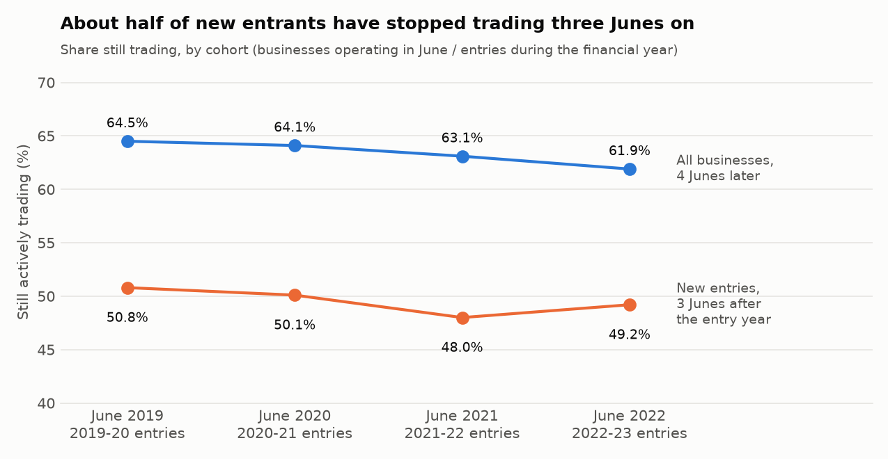
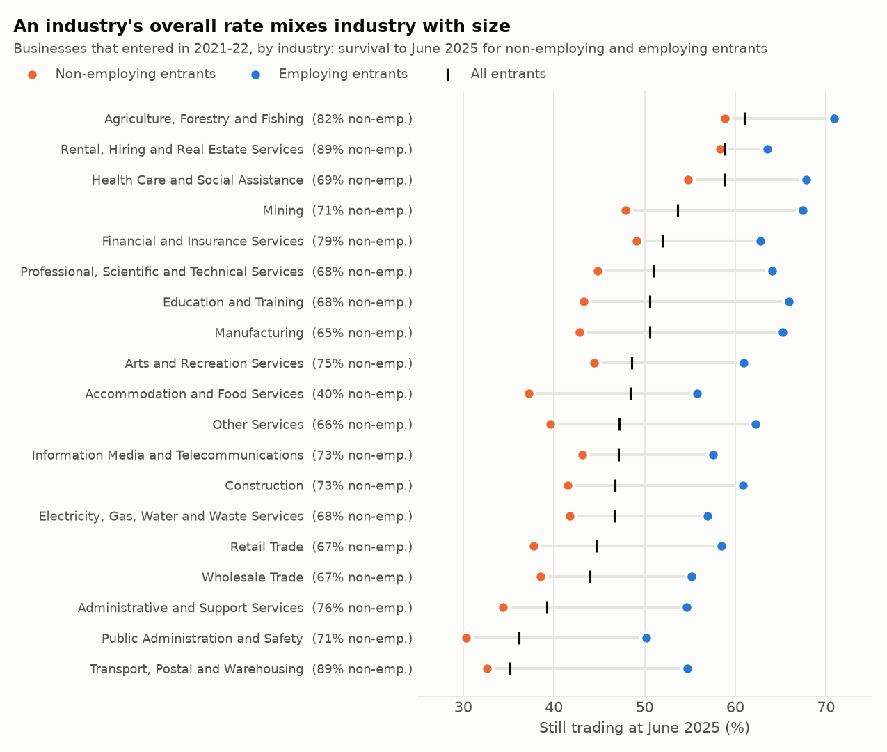
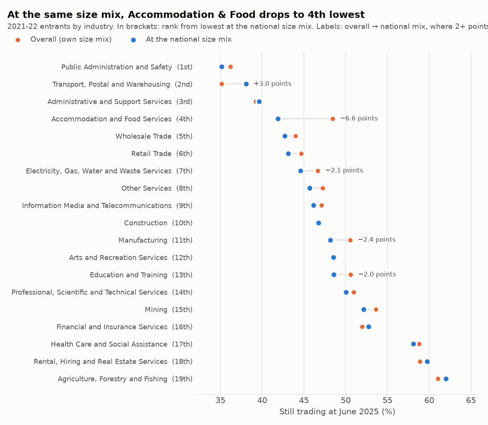
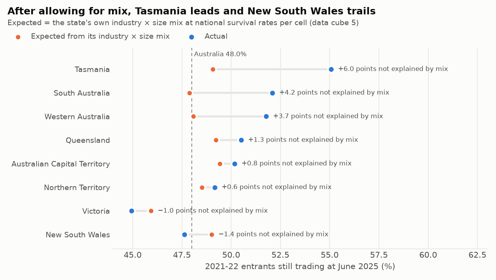
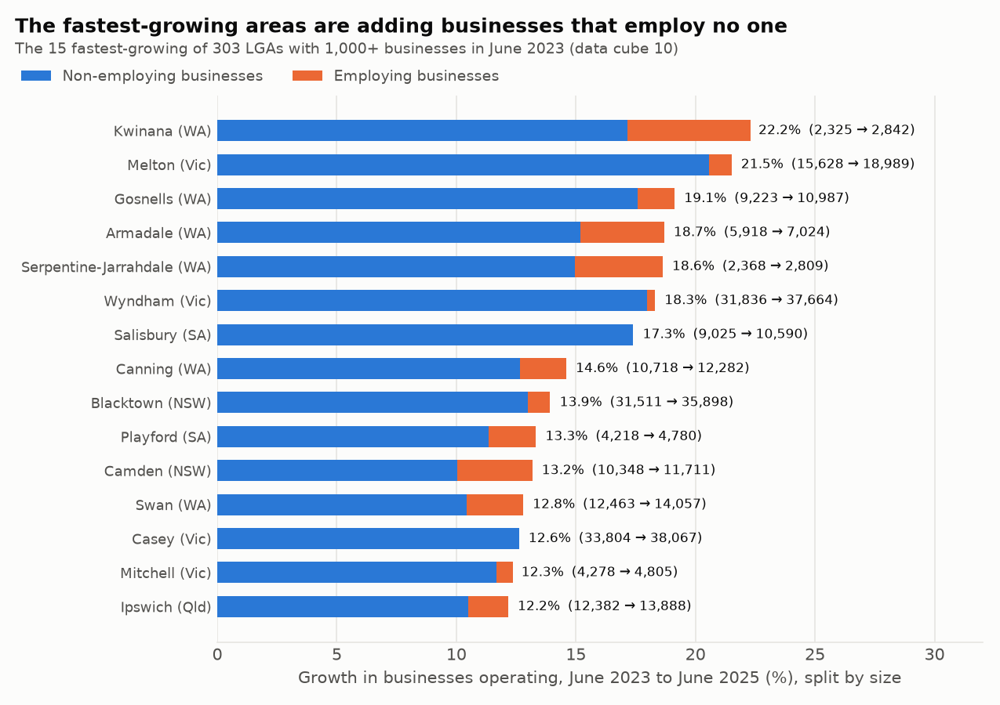

# New-business survival in Australia: which industries and regions new businesses last in

**Status: work in progress (Parts 1-3 of 5 done: source profile, industries, regions).**

About half of the businesses that start trading in Australia in a given year are no longer trading three
Junes later. That rate is
not the same everywhere. It depends on the industry, the state and, above all, on whether the business employs
anyone. This project uses the Australian Bureau of Statistics' official business counts to answer three
questions for people who back, plan for or advise new businesses:

- **A lender or investor:** how likely is a new business in this industry, state and size band to still be
  trading after three years, and how sure can we be of that figure?
- **A council or state agency:** where is the number of businesses growing or shrinking, and in which industries?
- **A small-business adviser:** which industries have the weakest early survival, once you compare businesses of
  the same size?

## Data

Australian Bureau of Statistics, [*Counts of Australian Businesses, including Entries and Exits*](https://www.abs.gov.au/statistics/economy/business-indicators/counts-australian-businesses-including-entries-and-exits)
(CABEE, cat. no. 8165.0). Licence: [CC BY 4.0](https://www.abs.gov.au/website-privacy-copyright-and-disclaimer),
© Commonwealth of Australia. No key or sign-up is needed.

- Data cube 1 from the four releases covering June 2019 – June 2023 through June 2022 – June 2026 (the latest,
  released 18 August 2026): national and state counts, entries, exits and survival. Four releases give four
  cohorts to compare.
- Data cubes 4, 5 and 10 from the June 2021 – June 2025 release: survival by state × ANZSIC subdivision ×
  employment size, and business counts for 557 local government areas. The 2026 versions are due on
  18 December 2026.

`scripts/download_data.py` fetches the 7 workbooks (about 4 MB) from abs.gov.au, with each file's SHA-256 pinned.
`scripts/build_snapshot.py` turns them into four tidy, gzipped CSVs in `data/` (about 1.2 MB, committed), so
every analysis runs without downloading anything.

## Part 1: what the numbers mean (`results/SOURCE_PROFILE.md`)

- **2,814,778 businesses** were actively trading at June 2026, up 24.1% from 2,268,998 at June 2019. Entries
  outnumbered exits in every one of the 7 years from 2019-20 to 2025-26.
- Of the **406,365 businesses that entered in 2022-23**, 199,742 (49.2%) were still trading at June 2026. The
  same figure was 50.8% for the 2019-20 entrants and 48.0% for the 2021-22 entrants, the lowest of the four
  cohorts.
- 73.2% of 2022-23 entrants employed no one. 44.6% of them were still trading at June 2026, against 61.5% of
  employing entrants.



Before any ranking, the profile checks the data and sets eight rules. The main ones:

1. **An exit isn't a failure.** It can be a sale, a restructure or a business that stopped remitting GST, so the
   project says "still trading" or "exited", never "failed".
2. **Not every entry is a start-up.** 28.5% to 31.7% of entries each year are re-activations or businesses
   coming into scope, and a business that opens and closes between two 30 Junes is never counted.
3. **Size mix drives industry rankings.** The non-employing share of entries ranges from 40% to 89% by industry.
   Accommodation and Food Services has the lowest share, so its overall rate is 10th lowest of 19, but its
   employing entrants' rate is 5th lowest. Industries are compared within a size band.
4. **Tiny cells mislead.** The detailed cubes are perturbed for confidentiality. 1,575 of 20,864 published rates
   don't match their own counts, all with a base of 15 businesses or fewer, so no rate is reported on a base of
   20 or fewer.
5. **Releases revise groups, not totals.** National totals never changed between releases (0 of 40 overlapping
   cells); industry and state groups moved by a median of 0.10%. A time series takes each year from the latest
   release.
6. **Survival below state level isn't published.** LGAs have counts only, so regional survival is a state
   comparison and LGAs are compared on growth in business numbers.



The data reconciles where it should: data cube 1's 1,288 published rates all match survived ÷ base to rounding,
its groups add exactly to its totals, the detailed cubes' state totals match data cube 1 exactly, and the LGA
cube's national totals match data cube 1's June counts for 2023, 2024 and 2025.

## Part 2: which industries new businesses last in (`results/INDUSTRY_SURVIVAL.md`)

Four entry cohorts by industry from data cube 1, then the 2021-22 entrants by industry × employment size from data
cube 5, compared at a common size mix (each industry's survival in each size band, weighted by the national share of
entrants in that band: non-employing 73.5%, 1-4 employees 24.1%, 5 or more 2.4%).

- **The bottom of the table doesn't move.** Administrative and Support Services; Public Administration and Safety;
  Transport, Postal and Warehousing; and Wholesale Trade are among the 5 industries with the lowest survival in all
  four entry cohorts. Transport, Postal and Warehousing is lowest in the latest: 37.4% of its 55,118 2022-23
  entrants were still trading three Junes on, against 49.2% for all industries.
- **Survival fell in 16 of 19 industries** from the 2019-20 to the 2022-23 cohort. Retail Trade fell the most
  (52.3% → 46.2%, −6.1 points).
- **It isn't a shift towards sole traders.** On unrounded counts, national survival moved −1.7 points: −1.8 points
  inside the size bands and +0.2 points from the size mix.
- **Size mix flatters some industries.** At the national size mix, Accommodation and Food Services falls from 10th
  to 4th lowest (48.4% → 41.9%), because only 40% of its entrants employ no one. In its Food and Beverage Services
  subdivision (cafés, restaurants, takeaways, pubs and clubs), 35.2% of non-employing entrants were still trading,
  against 54.7% of employing ones.
- **An industry average can hide a wide gap.** Among the 54 subdivisions with 500+ entrants, survival at the
  national size mix runs from 34.6% (Public Order, Safety and Regulatory Services) to 65.2% (Agriculture).
- **About half of the three-year loss happens by the first June.** In every industry, 45% to 52% of the 2022-23
  entrants that had stopped trading by the third June had already stopped by the first.



**What it means.** A lender should price a new business on its industry *and* its size: in every industry the
non-employing rate is 4.4 to 22.0 points below the 1-4 employee rate, and an industry's rate moved by up to 7.7
points across the four cohorts. Advisers should front-load support, since about half of the three-year loss has
happened by the first June. Retail Trade's fall is the largest of any industry and worth explaining.

The method was checked: the three size bands rebuild the published national rate to within 0.05 points, two
bands instead of three give an identical ranking, and no rate is shown on a base of 20 or fewer.

## Part 3: where new businesses last, and where business numbers are growing (`results/REGIONS.md`)

States across the four entry cohorts (data cube 1), states after allowing for their industry × size mix (data
cube 5, 2021-22 entrants) and growth in business numbers by local government area (LGA) from June 2023 to June 2025
(data cube 10). Survival isn't published below state level, so LGAs are compared on growth, and only the 303 LGAs
with 1,000 or more businesses are ranked.

- **Tasmania keeps its new businesses longest, in every cohort.** 54.7% of its 2022-23 entrants were still trading
  three Junes on, against 49.2% nationally; New South Wales was lowest at 48.0%.
- **Allowing for mix changes the picture.** A state's expected rate applies the national survival rate of each
  industry × size cell to the state's own entrants. New South Wales would be expected to keep 49.0% of its 2021-22
  entrants; it kept 47.6%, 1.4 points fewer, the weakest of the 8 states on that basis. Tasmania kept 6.0 points
  more than its mix predicts, then South Australia (+4.2 points) and Western Australia (+3.7 points).
- **Victoria's weak 2021-22 cohort is mostly mix.** Its entrants were 3.1 points below the national rate; 2.0
  points of that is its industry × size mix. 79% of them employed no one, the highest share of any state, and
  Victoria had 53% of the 8 states' entrants in Transport Support Services against 32.1% of entrants overall.
- **Business numbers grew by 139,482 across LGAs, but not in businesses with staff:** non-employing businesses grew
  by 149,180 and employing businesses fell by 9,698. In the 20 fastest-growing LGAs (8 of them in WA, led by
  Kwinana at 22.2%), 91.8% of the net increase employed no one and 39.5% was in Transport, Postal and Warehousing.
- **Counting employers tells a different story.** 199 of the 303 LGAs lost employing businesses even though only
  31 lost businesses overall.





**What it means.** Councils shouldn't read a rising business count as a growing local economy: in the fastest-growing
LGAs most of the increase is businesses with no employees, the largest share of it in the industry with the lowest
survival, so employing businesses (published in the same cube) are the better measure. State agencies should compare survival after the mix: New
South Wales is 0.4 points below the national rate on raw figures but the weakest state once its mix is allowed for,
while Victoria's 2021-22 dip is 65% mix. For lenders, the state effects (−1.4 points to +6.0 points) fine-tune the
industry × size rate from Part 2; they don't replace it.

The method was checked: a state's actual rate comes from data cube 5's state-total rows, which match data cube 1
exactly (summing its small perturbed cells would put the Northern Territory at 46.9% instead of 49.2%); with
subdivision instead of division cells, each state's unexplained part moves by at most 0.18 points.

## Plan

| Part | What | Status |
|---|---|---|
| 1 | Source, download with pinned hashes, tidy snapshot, profile and rules | done |
| 2 | Industries: survival within size bands, a common-size-mix comparison, subdivisions above the floor, cohort trends | done |
| 3 | Regions: state survival across four cohorts, states after their industry × size mix, LGA growth in business numbers | done |
| 4 | A DuckDB SQL layer and a benchmark table for lenders and advisers (industry × state × size, with reliability flags) | next |
| 5 | CI, recommendations, limitations and write-up | |

## How to run

```bash
python -m venv .venv && source .venv/bin/activate
pip install -r requirements.txt

python scripts/profile_source.py      # Part 1 report and charts from the committed snapshot
python scripts/industry_survival.py   # Part 2 report and charts
python scripts/regions_report.py      # Part 3 report and charts
python -m pytest                      # tests

# optional: rebuild the snapshot from the ABS files
python scripts/download_data.py       # 7 workbooks into data/raw/ (hash-checked)
python scripts/build_snapshot.py      # data/*.csv.gz and data/SNAPSHOT.json (byte-identical rebuild)
```

## Layout

```
cabee/load.py               parse the ABS workbooks into tidy tables; read the snapshot
cabee/profile.py            Part 1 checks and measures
cabee/industries.py         Part 2: size bands, common size mix, cohort trends, shift-share split
cabee/regions.py            Part 3: states by cohort, expected rates from the mix, LGA growth
scripts/download_data.py    fetch the workbooks, check SHA-256
scripts/build_snapshot.py   write data/*.csv.gz and data/SNAPSHOT.json
scripts/profile_source.py   write results/SOURCE_PROFILE.md, CSVs and charts 01-05
scripts/industry_survival.py  write results/INDUSTRY_SURVIVAL.md, CSVs and charts 06-09
scripts/regions_report.py   write results/REGIONS.md, CSVs and charts 10-14
data/                       the tidy snapshot (survival, flows, subdivision_survival, lga_counts)
results/                    reports, CSVs and charts
tests/                      parser tests on hand-made sheets, snapshot invariants, report checks
```

## Tests

95 tests: the parsers on hand-made sheets (including a perturbed row whose sizes don't add up), the snapshot's
invariants (entry cohorts equal that year's entries, start + entries − exits = end for every industry, every
subdivision maps to an ANZSIC division, LGA totals equal the national count), the profile measures on hand-made
frames, the real figures the report relies on, and a byte-for-byte regeneration of the Part 1 report, CSVs and
charts. If the raw workbooks are present, a test also rebuilds the snapshot from them and compares. 16 planted
bugs were tried on a scratch copy: 14 were caught at first, and the 2 that survived (a mislabelled state total,
a looser mismatch threshold) now have tests. README tests check that every Part 1 figure here appears in the
generated report and stays with its subject; 14 planted errors in this README (changed figures, swapped subjects)
were tried, 12 were caught at first, and the 2 survivors now have exact checks.

Part 2 adds 19 tests: the measures on hand-made frames (size bands folded and summed over states, the floor at
exactly 20, a common-mix rate left blank when a band is missing, a shift-share split whose parts add up and isolate
each effect, cohort ranks), the real figures (the bands rebuild the published national rate, divisions add up to
the national total within 10 businesses, subdivisions add up to divisions, no rate on a base of 20 or fewer, Part
1's division rates reproduced exactly) and a byte-for-byte regeneration of the Part 2 outputs. 14 planted bugs in
`cabee/industries.py` were tried on a scratch copy, and all 14 were caught. 19 planted errors in this
README's Part 2 text were tried; 18 were caught at first, and the survivor ("about a third" for "about half")
now has an exact check.

Part 3 adds 21 tests (17 in `tests/test_regions.py`, 4 README checks): the measures on hand-made frames (the
expected rate is an indirect standardisation on national cell rates and equals the actual rate when states share the
same rates, the mix split adds up exactly, state size bands come from the state-total rows with the floor at exactly
20, the Victorian excess sums to zero, LGA growth leaves out "No usual address" and Other Territories, the LGA floor
is inclusive), the real figures (state rows equal data cube 1's counts exactly, state counts add to the national
total, the small-cell bias, the three cell definitions agree, the LGA size bands add up) and a byte-for-byte
regeneration of the Part 3 outputs. 18 planted bugs in `cabee/regions.py` were tried on a scratch copy, and all 18
were caught. 26 planted errors in this README's Part 3 text were tried; 25 were caught at first, and the survivor
("strongest" for "weakest") now has an exact check.

## Credit

Data: Australian Bureau of Statistics, CC BY 4.0, © Commonwealth of Australia.
