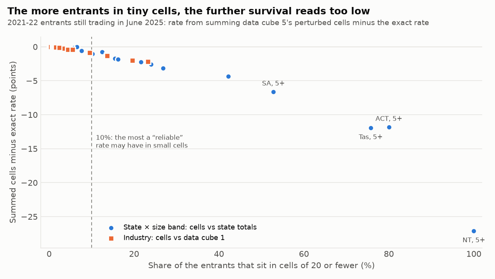
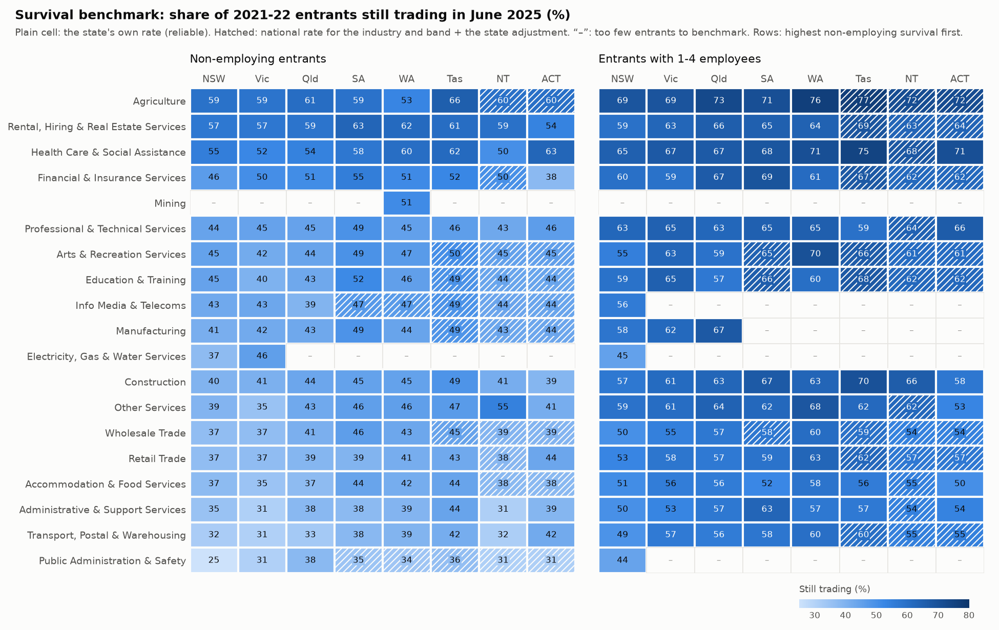
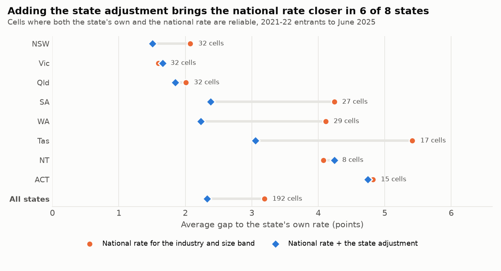

# Part 4: a SQL layer and a survival benchmark for lenders and advisers

Generated by `scripts/benchmark_report.py` from the SQL in `sql/`, run by DuckDB directly over the committed snapshot (`data/*.csv.gz`). Every figure below comes from that script.

**Question:** if a lender or adviser knows a new business's industry, state and size, what share of businesses like it were still trading three years on, and how much can that figure be trusted?

## 1. The SQL layer

Seven SQL files build every table the benchmark needs as DuckDB views over the gzipped CSVs, so no database file is written and any DuckDB client gives the same answers. The rules from Part 1 (the 20-business floor, the three size bands, the one detail cohort) are SQL macros in the first file, so every view uses the same ones.

| File | Views |
|---|---|
| `sql/01_sources.sql` | `survival`, `flows`, `subdivision_survival`, `lga_counts`, `detail_entrants` |
| `sql/02_cohorts.sql` | `entry_cohorts`, `division_cohorts`, `national_bands` |
| `sql/03_industries.sql` | `division_band_counts`, `division_bands` |
| `sql/04_states.sql` | `state_bands`, `state_cells`, `national_cells`, `state_expected`, `state_mix` |
| `sql/05_lgas.sql` | `lga_places`, `lga_growth` |
| `sql/06_perturbation.sql` | `perturbation_check` |
| `sql/07_benchmark.sql` | `benchmark`, `benchmark_fit` |

**The SQL gives the same numbers as the pandas analysis.** `cabee.sql.parity_checks` rebuilds 10 tables from Parts 1-3 in SQL (national cohorts, industries across cohorts and within size bands, states across cohorts and after their mix, LGA growth) and compares 57 columns, 6,052 values in all, with the pandas functions: **0 mismatches**; every difference is below 1e-12, i.e. floating-point rounding. The column-by-column result is in `results/sql_parity.csv`.

## 2. Before benchmarking: how much perturbation pulls small cells down

To protect confidentiality the ABS perturbs data cube 5. One visible sign: across its 32,508 subdivision cells, no count of 1 or 2 appears (published counts jump from 0 to 3). A benchmark for one industry in one state and size band is a sum of such cells, so the question is how far a sum of small cells drifts from the truth. Two places publish both a sum of cells and an exact figure: each state × size band (its subdivision cells vs the state-total rows), and each industry division (its cells summed over states vs data cube 1, which isn't perturbed).

- **Summed cells read low, and the more entrants sit in cells of 20 or fewer, the lower.** The worst case is NT, 5+: 48.1% from the cells against 75.2% exact (−27.1 points), with 100% of entrants in small cells. In no check does the sum read more than 0.05 points high.
- **Where at most 10% of entrants are in small cells, the sum is within 0.86 points of the exact rate** (27 of the 43 checks; the largest gap is Manufacturing). Above 10%, gaps run from −0.7 points to −27.1 points.
- **The 5+ employee band is the most affected.** Every state's 5+ band has 16% or more of its entrants in small cells, and its summed rate is 1.9 to 27.1 points too low.

**What this means for Part 2.** Part 2's industry rates within size bands are summed cells too. 4 small industries read more than a point low: Mining (−2.2 points), Electricity, Gas, Water and Waste Services (−2.0 points), Public Administration and Safety (−1.3 points), Information Media and Telecommunications (−1.2 points). Shifting each industry's band rates by its own measured gap and re-ranking at the common size mix moves no industry more than 2 places, and the bottom five are unchanged, so Part 2's ranking holds.

**The rule this sets for the benchmark.** A rate is **reliable** when it rests on 100+ entrants (one business more or less moves it by at most 1 point) and at most 10% of them are in cells of 20 or fewer. Above 20 entrants but short of that, it is shown as **use with care**. At 20 or fewer, no rate is shown (Part 1, rule 6).

## 3. The benchmark

`results/benchmark.csv` has one row per state × industry division × size band (456 rows) for businesses that entered in 2021-22, the one cohort with this detail. For each it gives:

- **observed**: the share still trading three Junes later (June 2025) in that state, with its flag;
- **national_rate**: the same industry and size band across the 8 states, with its flag;
- **state_adjustment**: Part 3's state effect, the state's actual rate minus the rate its industry × size mix would give at national rates (points);
- **benchmark**: the observed rate if it is reliable; otherwise the national rate plus the state adjustment, if the national rate is reliable; otherwise blank. `benchmark_source` says which.

| Size band | Cells | Own rate reliable | Use with care | No rate | Benchmark from own rate | From national + adjustment | No benchmark | Entrants covered |
|---|---|---|---|---|---|---|---|---|
| non-employing | 152 | 111 | 33 | 8 | 111 | 28 | 13 | 99.8% |
| 1-4 employees | 152 | 86 | 45 | 21 | 86 | 32 | 34 | 98.0% |
| 5+ employees | 152 | 11 | 65 | 76 | 11 | 4 | 137 | 38.2% |

- **The benchmark covers 97.9% of the 441,808 entrants** in the 8 states (unknown industry left out), because almost all of them are non-employing or have 1-4 employees.
- **For businesses with 5+ employees there is a benchmark in only 15 of 152 cells.** Industry detail for larger entrants is too thin and too perturbed. For these, use the exact all-industry rate for the state from the state-total rows, which perturbation doesn't distort:

| State | NSW | Vic | Qld | SA | WA | Tas | NT | ACT |
|---|---|---|---|---|---|---|---|---|
| 5+ employees, all industries | 66.6% | 71.1% | 71.6% | 73.3% | 73.0% | 76.5% | 75.2% | 64.8% |

## 4. Does the state adjustment work?

Where both a state's own rate and the national rate are reliable (192 cells, 421,780 entrants), the shortcut can be compared with the real figure. This is a fit check on the same cohort, not a forecast test: the state adjustment was itself built from these states' entrants.

| State | Cells | Average gap: national rate | With state adjustment | Entrant-weighted: national | With adjustment | Cells closer with adjustment |
|---|---|---|---|---|---|---|
| NSW | 32 | 2.08 | 1.51 | 1.55 | 1.10 | 69% |
| Vic | 32 | 1.59 | 1.66 | 1.61 | 1.22 | 44% |
| Qld | 32 | 2.01 | 1.85 | 1.50 | 1.32 | 53% |
| SA | 27 | 4.24 | 2.38 | 4.11 | 1.82 | 74% |
| WA | 29 | 4.11 | 2.23 | 3.89 | 1.89 | 76% |
| Tas | 17 | 5.42 | 3.05 | 5.91 | 2.83 | 71% |
| NT | 8 | 4.08 | 4.24 | 2.93 | 3.24 | 38% |
| ACT | 15 | 4.82 | 4.75 | 4.39 | 4.31 | 53% |
| All states | 192 | 3.19 | 2.33 | 1.98 | 1.35 | 61% |

- **Overall the adjustment cuts the average gap from 3.19 to 2.33 points** (1.98 to 1.35 weighted by entrants), and brings 61% of cells closer.
- It helps most where the state effect is largest: Tas (5.42 → 3.05), WA (4.11 → 2.23), SA (4.24 → 2.38).
- On the simple average it doesn't help in Vic or NT, where the adjustments are small (Vic −1.0 points, NT +0.6 points); weighted by entrants it does help in Vic (1.61 → 1.22), so its largest cells do move with the state. Where an adjustment is that small, the national rate is about as good a fallback.
- Even with the adjustment, 18 of the 192 cells sit more than 5 points from it. The largest: NT Other Services, non-employing: 54.6% vs 40.3% (108 entrants); ACT Financial & Insurance Services, non-employing: 37.8% vs 49.9% (156 entrants); Tas Professional & Technical Services, 1-4 employees: 59.4% vs 69.6% (175 entrants). A local figure that is reliable beats the shortcut, which is why the benchmark uses it first.

## 5. What the benchmark says

- **Lowest reliable rates:** NSW Public Administration & Safety, non-employing: 25.1% of 383; Vic Transport, Postal & Warehousing, non-employing: 30.6% of 22,981; Vic Public Administration & Safety, non-employing: 30.8% of 491; Vic Administrative & Support Services, non-employing: 30.8% of 9,011; NT Administrative & Support Services, non-employing: 31.1% of 148.
- **Highest reliable rates:** WA Agriculture, 1-4 employees: 76.5% of 221; Qld Professional & Technical Services, 5+ employees: 75.4% of 187; Tas Health Care & Social Assistance, 1-4 employees: 75.0% of 100; NSW Professional & Technical Services, 5+ employees: 74.2% of 314; Qld Agriculture, 1-4 employees: 73.1% of 535.
- Reliable non-employing rates run from 25.1% to 65.5%; 1-4 employee rates from 44.4% to 76.5%. Within the same state and industry, entrants with 1-4 employees out-survived non-employing ones in all 85 pairs where both are reliable (median gap +16.6 points).

**Worked example: Accommodation & Food Services, 1-4 employees** (national rate 53.9%, 9,868 entrants, reliable)

| State | Entrants | Own rate | Flag | Benchmark | Source |
|---|---|---|---|---|---|
| NSW | 3,267 | 50.9% | reliable | 50.9% | this state |
| Vic | 2,771 | 55.5% | reliable | 55.5% | this state |
| Qld | 1,903 | 56.1% | reliable | 56.1% | this state |
| SA | 613 | 52.4% | reliable | 52.4% | this state |
| WA | 809 | 58.3% | reliable | 58.3% | this state |
| Tas | 208 | 55.8% | reliable | 55.8% | this state |
| NT | 90 | 40.0% | use with care | 54.5% | national + state adjustment |
| ACT | 207 | 50.2% | reliable | 50.2% | this state |

Where the state's own rate is reliable it runs from 50.2% (ACT) to 58.3% (WA), 8.1 points apart.

Where the own rate isn't reliable the table shows it anyway, so a reader can see how far it is from the benchmark: NT 40.0% on 90 entrants vs 54.5%. The data can't say which is closer to the truth; a difference that size on so few entrants is a reason to ask more questions, not to decline.

**Worked example: Construction, non-employing** (national rate 41.5%, 58,536 entrants, reliable)

| State | Entrants | Own rate | Flag | Benchmark | Source |
|---|---|---|---|---|---|
| NSW | 19,037 | 39.7% | reliable | 39.7% | this state |
| Vic | 18,839 | 40.6% | reliable | 40.6% | this state |
| Qld | 9,896 | 43.7% | reliable | 43.7% | this state |
| SA | 3,215 | 44.8% | reliable | 44.8% | this state |
| WA | 5,484 | 44.8% | reliable | 44.8% | this state |
| Tas | 857 | 48.8% | reliable | 48.8% | this state |
| NT | 323 | 41.5% | reliable | 41.5% | this state |
| ACT | 885 | 38.9% | reliable | 38.9% | this state |

Where the state's own rate is reliable it runs from 38.9% (ACT) to 48.8% (Tas), 9.9 points apart.

Look up any combination with `python scripts/benchmark_lookup.py "<industry>" <state> <size band>`.

## 6. What this means for the business

- **Lenders and investors:** use the benchmark as the starting point for a new business's three-year survival, not the national average. Industry and size move the rate far more than state does: reliable national rates for an industry and size band run from 30.3% to 70.9%, while the state adjustment fine-tunes it by −1.4 points to +6.0 points. Carry the flag into the credit file: a "use with care" rate should widen the range considered, not set the price.
- **For larger entrants (5+ employees) don't use industry detail from this release.** Only 15 of 152 cells have a benchmark; the state-level 5+ rates above are exact.
- **Small-business advisers:** the benchmark gives a client a fair comparison: businesses of the same industry, size and state. The worked examples show the spread a café owner or a sole-trader tradie faces depending on where they start.
- **Analysts:** the SQL layer reproduces the key Part 1-3 tables exactly, so the same figures can feed a BI tool or a credit system straight from SQL without re-running Python. Check the perturbation before trusting any sum of small cells.

## Caveats

- One cohort: 2021-22 entrants to June 2025. Data cube 1 shows how much survival moves between cohorts (Parts 1-3), and the 2026 detail is due on 18 December 2026.
- "Still trading" isn't "didn't fail": an exit can be a sale, a restructure or a business that stopped remitting GST (Part 1, rule 1). The benchmark says nothing about profit or loan repayment.
- The state adjustment is one number per state for all industries and sizes. Section 4 shows where that holds and where it doesn't.
- Even reliable rates are summed perturbed cells, read up to 0.86 points low by the checks in section 2.

## Output files

- `results/benchmark.csv`: state × industry division × size band, observed and national rates with flags, the state adjustment and the benchmark
- `results/benchmark_fit.csv`: section 4, by state
- `results/perturbation_check.csv`: section 2, every summed-cells vs exact comparison
- `results/sql_parity.csv`: the SQL vs pandas comparison, column by column
