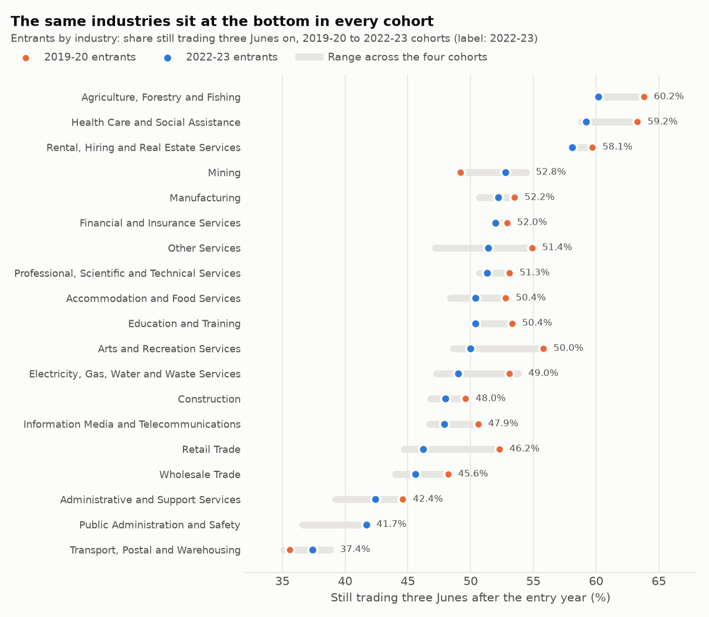
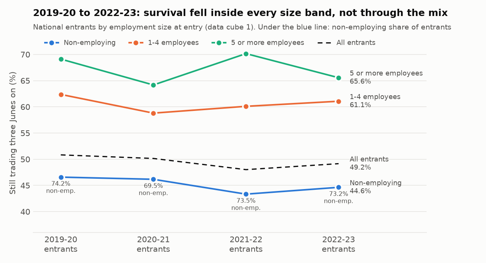
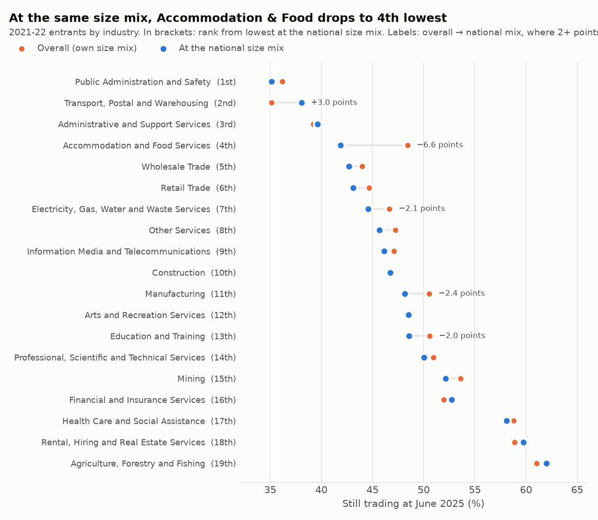
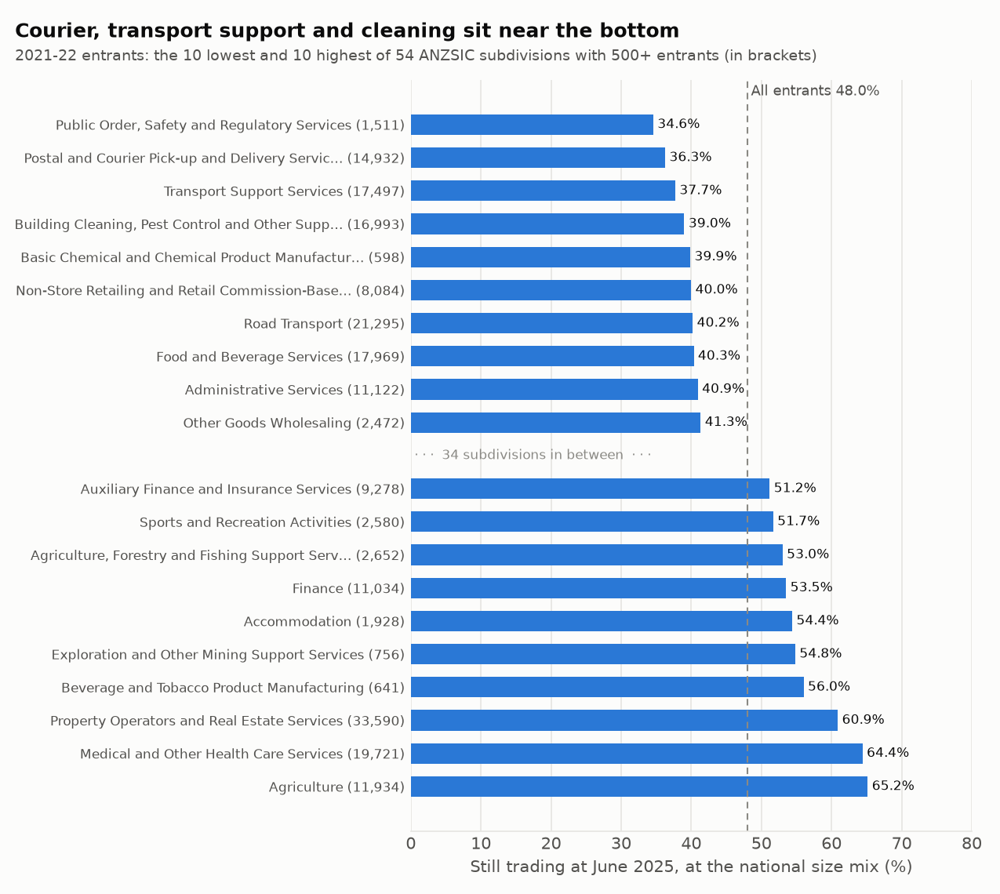

# Part 2: which industries new businesses last in

*Generated by `scripts/industry_survival.py` from the snapshot in `data/`. Do not edit by hand.*

Part 1's rules apply throughout: survival means "still actively trading" at 30 June (an exit isn't a failure); industries are compared within size bands or at a common size mix; no rate on a base of 20 businesses or fewer, and perturbed cells are summed before a rate is computed; 'Currently Unknown' is left out of rankings.

## At a glance

- **The bottom of the table doesn't move.** Administrative and Support Services; Public Administration and Safety; Transport, Postal and Warehousing; and Wholesale Trade are among the 5 industries with the lowest survival in all four entry cohorts (2019-20 to 2022-23). Transport, Postal and Warehousing is lowest in the latest cohort: 37.4% of its 55,118 2022-23 entrants were still trading three Junes on, against 49.2% for all industries.
- **Survival fell in 16 of 19 industries** between the 2019-20 and 2022-23 cohorts. Retail Trade fell the most (52.3% → 46.2%, −6.1 points), then Arts and Recreation Services (−5.8 points).
- **The national fall isn't a shift towards sole traders.** National survival went from 50.8% for the 2019-20 cohort to 49.2% for the 2022-23 cohort. On unrounded counts that is −1.7 points: −1.8 points inside the size bands and +0.2 points from the size mix.
- **Size mix flatters some industries.** At the national size mix of 2021-22 entrants, Accommodation and Food Services falls from 10th to 4th lowest (48.4% → 41.9%): only 40% of its entrants employ no one, against 74% nationally. Transport, Postal and Warehousing is the opposite case: 89% non-employing, so its overall rate is 3.0 points below its rate at the national mix (35.1% → 38.1%).
- **An industry average can hide a wide gap.** Among the 54 subdivisions with 500+ entrants, survival at the national size mix runs from 34.6% (Public Order, Safety and Regulatory Services) to 65.2% (Agriculture). Within Accommodation and Food Services, Food and Beverage Services is at 40.3% and Accommodation at 54.4%.
- **About half of the three-year loss happens by the first June.** In every industry, 45% to 52% of the 2022-23 entrants that had stopped trading by the third June had already stopped by the first (47% nationally).

## 1. Four cohorts by industry (data cube 1, not perturbed)

Share of each cohort's entrants still trading three Junes after the entry year (the 2022-23 entrants at June 2026). Sorted by the 2022-23 cohort; rank 1 = lowest survival.

| Industry | 2019-20 | 2020-21 | 2021-22 | 2022-23 | Change | 2022-23 entrants | Rank | Cohorts in bottom 5 |
|---|---|---|---|---|---|---|---|---|
| Transport, Postal and Warehousing | 35.6% | 38.8% | 35.1% | 37.4% | +1.8 | 55,118 | 1 | 4 |
| Public Administration and Safety | 41.7% | 39.4% | 36.6% | 41.7% | 0.0 | 1,370 | 2 | 4 |
| Administrative and Support Services | 44.6% | 43.6% | 39.2% | 42.4% | −2.2 | 24,806 | 3 | 4 |
| Wholesale Trade | 48.2% | 45.4% | 44.0% | 45.6% | −2.6 | 11,203 | 4 | 4 |
| Retail Trade | 52.3% | 48.5% | 44.7% | 46.2% | −6.1 | 23,766 | 5 | 2 |
| Information Media and Telecommunications | 50.6% | 46.7% | 47.3% | 47.9% | −2.7 | 3,865 | 6 | 1 |
| Construction | 49.6% | 48.4% | 46.8% | 48.0% | −1.6 | 73,113 | 7 | 0 |
| Electricity, Gas, Water and Waste Services | 53.1% | 53.8% | 47.3% | 49.0% | −4.1 | 1,256 | 8 | 0 |
| Arts and Recreation Services | 55.8% | 49.7% | 48.6% | 50.0% | −5.8 | 6,649 | 9 | 0 |
| Education and Training | 53.3% | 51.5% | 50.6% | 50.4% | −2.9 | 6,408 | 10 | 0 |
| Accommodation and Food Services | 52.8% | 48.5% | 48.4% | 50.4% | −2.4 | 18,340 | 10 | 0 |
| Professional, Scientific and Technical Services | 53.1% | 50.7% | 51.0% | 51.3% | −1.8 | 51,382 | 12 | 0 |
| Other Services | 54.9% | 50.9% | 47.2% | 51.4% | −3.5 | 21,766 | 13 | 0 |
| Financial and Insurance Services | 52.9% | 52.7% | 52.0% | 52.0% | −0.9 | 18,658 | 14 | 0 |
| Manufacturing | 53.5% | 52.3% | 50.7% | 52.2% | −1.3 | 11,228 | 15 | 0 |
| Mining | 49.2% | 53.7% | 54.4% | 52.8% | +3.6 | 980 | 16 | 1 |
| Rental, Hiring and Real Estate Services | 59.7% | 58.9% | 58.9% | 58.1% | −1.6 | 32,553 | 17 | 0 |
| Health Care and Social Assistance | 63.3% | 62.0% | 58.8% | 59.2% | −4.1 | 29,722 | 18 | 0 |
| Agriculture, Forestry and Fishing | 63.8% | 62.6% | 61.1% | 60.2% | −3.6 | 13,845 | 19 | 0 |
| **All industries** | 50.8% | 50.1% | 48.0% | 49.2% | −1.6 | 406,365 | | |

Change is in percentage points, 2019-20 to 2022-23.

- **Rankings are stable but not fixed.** The rank correlation between any two cohorts is 0.77 to 0.95. Industries moved by up to 7.7 points across the four cohorts (Other Services), so one cohort's rate is a guide, not a constant.
- **Retail Trade is the one to watch.** It fell from 52.3% to 46.2% and was in the bottom 5 in 2 of 4 cohorts, the two latest included.
- **Only 2 industries improved:** Mining (+3.6 points, 980 entrants); Transport, Postal and Warehousing (+1.8 points, 55,118 entrants).
- **The top three are the same in every cohort:** Agriculture, Forestry and Fishing (60.2% in 2022-23), Health Care and Social Assistance (59.2%) and Rental, Hiring and Real Estate Services (58.1%).

## 2. Is the national fall just more sole traders?

No. National survival can fall because each size band does worse, or because the mix shifts towards non-employing entrants, who survive less. A shift-share split (average weights × change in rates, plus change in weights × average rates; the two parts add to the total) separates the two. Changes are computed from counts, so they can differ by 0.1 from the gap between the rounded published rates:

| Cohorts | Change in national survival | Inside the size bands | From the size mix |
|---|---|---|---|
| 2019-20 → 2020-21 | −0.7 points | −1.3 points | +0.7 points |
| 2020-21 → 2021-22 | −2.1 points | −1.5 points | −0.6 points |
| 2021-22 → 2022-23 | +1.1 points | +1.1 points | +0.1 points |
| 2019-20 → 2022-23 | −1.7 points | −1.8 points | +0.2 points |

From 2019-20 to 2022-23, non-employing entrants' survival moved −1.9 points, 1-4 employees −1.3 points and 5 or more −3.6 points. The non-employing share of entrants was 74.2% in 2019-20 and 73.2% in 2022-23; the 2020-21 cohort had the lowest share (69.5%), which is why the mix added +0.7 points that year and took back 0.6 points the next. The three bands' rates rebuilt from data cube 1 give the published national rate to within 0.05 points.

## 3. Industries within size bands and at a common size mix (data cube 5)

Entrants of 2021-22, still trading at June 2025, summed over states. Bands: non-employing, 1-4 employees, 5 or more (20-199 and 200+ are folded in because by industry they fall under the floor; 20+ employee entrants: Mining 15, Other Services 16, Electricity, Gas, Water and Waste Services 18). The common-mix rate weights each industry's band rates by the national share of 2021-22 entrants in that band (Non-employing 73.5%, 1-4 24.1%, 5+ 2.4%). Rank 1 = lowest survival.

| Industry | Entrants | Non-employing share | Overall | Non-employing | 1-4 | 5+ | At national mix | Rank overall | Rank at mix |
|---|---|---|---|---|---|---|---|---|---|
| Public Administration and Safety | 1,622 | 70% | 36.2% | 30.3% | 49.7% | 36.4% | 35.2% | 2 | 1 |
| Transport, Postal and Warehousing | 54,849 | 89% | 35.1% | 32.6% | 54.0% | 45.8% | 38.1% | 1 | 2 |
| Administrative and Support Services | 28,115 | 76% | 39.2% | 34.4% | 53.5% | 60.1% | 39.6% | 3 | 3 |
| Accommodation and Food Services | 19,897 | 40% | 48.4% | 37.2% | 53.9% | 63.9% | 41.9% | 10 | 4 |
| Wholesale Trade | 11,705 | 67% | 44.0% | 38.6% | 53.4% | 62.3% | 42.7% | 4 | 5 |
| Retail Trade | 27,856 | 67% | 44.7% | 37.8% | 56.4% | 72.7% | 43.1% | 5 | 6 |
| Electricity, Gas, Water and Waste Services | 1,316 | 68% | 46.7% | 41.8% | 51.6% | 60.7% | 44.6% | 6 | 7 |
| Other Services | 24,970 | 66% | 47.2% | 39.6% | 61.7% | 70.7% | 45.7% | 9 | 8 |
| Information Media and Telecommunications | 4,384 | 73% | 47.1% | 43.1% | 55.7% | 41.8% | 46.1% | 8 | 9 |
| Construction | 80,351 | 73% | 46.8% | 41.5% | 60.6% | 66.5% | 46.7% | 7 | 10 |
| Manufacturing | 12,784 | 65% | 50.6% | 42.8% | 62.7% | 66.6% | 48.1% | 12 | 11 |
| Arts and Recreation Services | 7,274 | 75% | 48.5% | 44.5% | 60.3% | 54.1% | 48.5% | 11 | 12 |
| Education and Training | 7,985 | 68% | 50.6% | 43.3% | 61.5% | 80.7% | 48.6% | 13 | 13 |
| Professional, Scientific and Technical Services | 55,413 | 68% | 51.0% | 44.8% | 63.6% | 73.8% | 50.0% | 14 | 14 |
| Mining | 1,188 | 71% | 53.6% | 47.9% | 66.3% | 38.6% | 52.1% | 16 | 15 |
| Financial and Insurance Services | 20,381 | 79% | 52.0% | 49.1% | 61.3% | 77.9% | 52.7% | 15 | 16 |
| Health Care and Social Assistance | 28,378 | 69% | 58.8% | 54.8% | 66.9% | 70.4% | 58.1% | 17 | 17 |
| Rental, Hiring and Real Estate Services | 38,201 | 89% | 58.9% | 58.3% | 62.7% | 75.0% | 59.8% | 18 | 18 |
| Agriculture, Forestry and Fishing | 15,516 | 82% | 61.0% | 58.9% | 70.9% | 68.1% | 62.0% | 19 | 19 |

- **Accommodation and Food Services** has the lowest non-employing share (40%; next lowest 65%), so its overall rate (48.4%) is 6.6 points above its rate at the national mix (41.9%). Within each band it is 4th lowest (non-employing), 5th (1-4) and 9th (5+). For a lender, a non-employing entrant in Food and Beverage Services (cafés, restaurants, takeaways, pubs and clubs) is a weaker prospect than the industry's overall rate suggests: 35.2% of them were still trading, against 54.7% of employing ones.
- **Transport, Postal and Warehousing** is lowest overall (35.1%) but 2nd lowest at the national mix (38.1%): 89% of its entrants employ no one. Its non-employing entrants rank 2nd lowest (32.6%) but its 1-4 employee entrants only 6th lowest (54.0%).
- **Employing entrants last longer in every industry.** The 1-4 band beats the non-employing band in all 19 industries, by 4.4 to 22.0 points. The 5+ band is noisier (bases of 44 to 2,139) and is below the 1-4 band in 6 industries.
- **The method holds up.** With two bands (non-employing, employing) instead of three, every industry's common-mix rate moves by at most 0.56 points and the ranking is identical. The overall rates rebuilt here from data cube 5 are within 0.78 points of data cube 1's published ones (Part 1).

## 4. Subdivisions (data cube 5)

The 85 ANZSIC subdivisions with entrants, summed over states. With three bands, too many small subdivisions fall under the floor in the 5+ band, so the common mix uses two: non-employing (73.5%) and employing (26.5%). 77 subdivisions clear the floor in both bands; 8 don't (Library and Other Information Services, Water Supply, Sewerage and Drainage Services, Metal Ore Mining, Oil and Gas Extraction, Coal Mining, Gas Supply, Rail Transport, Defence). The tables below show the 54 with 500 or more entrants (98.8% of all entrants); the rest are in `results/subdivision_survival.csv`.

**Lowest 10 at the national size mix**

| Subdivision | Industry | Entrants | Non-employing share | Overall | Non-employing | Employing | At national mix |
|---|---|---|---|---|---|---|---|
| Public Order, Safety and Regulatory Services (77) | Public Administration and Safety | 1,511 | 71% | 35.7% | 29.7% | 48.1% | 34.6% |
| Postal and Courier Pick-up and Delivery Services (51) | Transport, Postal and Warehousing | 14,932 | 89% | 33.6% | 31.7% | 49.0% | 36.3% |
| Transport Support Services (52) | Transport, Postal and Warehousing | 17,497 | 98% | 31.3% | 30.7% | 57.1% | 37.7% |
| Building Cleaning, Pest Control and Other Support Services (73) | Administrative and Support Services | 16,993 | 81% | 37.5% | 33.6% | 54.0% | 39.0% |
| Basic Chemical and Chemical Product Manufacturing (18) | Manufacturing | 598 | 72% | 41.6% | 36.2% | 50.0% | 39.9% |
| Non-Store Retailing and Retail Commission-Based Buying and/or Selling (43) | Retail Trade | 8,084 | 79% | 39.4% | 36.6% | 49.4% | 40.0% |
| Road Transport (46) | Transport, Postal and Warehousing | 21,295 | 81% | 38.6% | 34.6% | 55.7% | 40.2% |
| Food and Beverage Services (45) | Accommodation and Food Services | 17,969 | 37% | 47.5% | 35.2% | 54.7% | 40.3% |
| Administrative Services (72) | Administrative and Support Services | 11,122 | 69% | 41.9% | 35.9% | 54.8% | 40.9% |
| Other Goods Wholesaling (37) | Wholesale Trade | 2,472 | 72% | 41.8% | 36.1% | 55.9% | 41.3% |

**Highest 10 at the national size mix**

| Subdivision | Industry | Entrants | Non-employing share | Overall | Non-employing | Employing | At national mix |
|---|---|---|---|---|---|---|---|
| Agriculture (01) | Agriculture, Forestry and Fishing | 11,934 | 83% | 63.9% | 61.6% | 75.0% | 65.2% |
| Medical and Other Health Care Services (85) | Health Care and Social Assistance | 19,721 | 71% | 64.7% | 61.3% | 73.2% | 64.4% |
| Property Operators and Real Estate Services (67) | Rental, Hiring and Real Estate Services | 33,590 | 90% | 60.1% | 59.7% | 64.3% | 60.9% |
| Beverage and Tobacco Product Manufacturing (12) | Manufacturing | 641 | 71% | 56.9% | 54.0% | 61.5% | 56.0% |
| Exploration and Other Mining Support Services (10) | Mining | 756 | 67% | 56.3% | 51.1% | 65.2% | 54.8% |
| Accommodation (44) | Accommodation and Food Services | 1,928 | 63% | 57.2% | 48.4% | 71.0% | 54.4% |
| Finance (62) | Financial and Insurance Services | 11,034 | 85% | 52.2% | 50.5% | 61.9% | 53.5% |
| Agriculture, Forestry and Fishing Support Services (05) | Agriculture, Forestry and Fishing | 2,652 | 76% | 52.8% | 50.2% | 60.8% | 53.0% |
| Sports and Recreation Activities (91) | Arts and Recreation Services | 2,580 | 55% | 54.8% | 47.6% | 63.0% | 51.7% |
| Auxiliary Finance and Insurance Services (64) | Financial and Insurance Services | 9,278 | 72% | 51.6% | 47.0% | 62.8% | 51.2% |

- **The five weakest have more non-employing entrants than average.** Public Order, Safety and Regulatory Services, Postal and Courier Pick-up and Delivery Services, Transport Support Services, Building Cleaning, Pest Control and Other Support Services and Basic Chemical and Chemical Product Manufacturing have the five lowest common-mix rates (34.6% to 39.9%); together they had 51,531 entrants, 11.7% of all 2021-22 entrants, 89% of them non-employing (against 74% nationally).
- **The five strongest:** Agriculture (65.2%), Medical and Other Health Care Services (64.4%), Property Operators and Real Estate Services (60.9%), Beverage and Tobacco Product Manufacturing (56.0%) and Exploration and Other Mining Support Services (54.8%).
- **One division can hold both ends.** In Accommodation and Food Services, Food and Beverage Services is at 40.3% at the national mix and Accommodation at 54.4%; a division-level benchmark hides that gap.

## 5. What this means for the business

- **Lenders and investors:** price a new business on its industry *and* its size, not the industry's overall rate. For a non-employing entrant the relevant figure is the non-employing column, which is 4.4 to 22.0 points below the 1-4 employee column in every industry. Use the range across cohorts (section 1) as a guide to how much an industry's rate can move, not one year's rate alone.
- **Small-business advisers and programmes:** support should be front-loaded. About half of the three-year loss has happened by the first June in every industry, so the first one to two years after entering are where help counts. On a like-for-like basis, the industries where entrants most need it are Public Administration and Safety, Transport, Postal and Warehousing, Administrative and Support Services, Accommodation and Food Services and Wholesale Trade.
- **Policy and industry bodies:** Retail Trade's fall (−6.1 points over four cohorts) is the largest of any industry and worth explaining. The national decline happened inside every size band, so it isn't explained by more sole traders registering.

## Caveats

- Sections 3 and 4 cover one cohort (2021-22 entrants to June 2025); the industry × size detail for later cohorts is due on 18 December 2026. Section 1 shows how much a single cohort can move.
- Data cube 5 is perturbed. Rates are computed from counts summed over states, never from single cells, and bands with 20 or fewer businesses get no rate. Because cells are perturbed, the size bands don't add exactly to the published totals.
- The common-mix rate is a what-if (the industry's own band rates at the national size mix), not a forecast. It removes the effect of size, not of anything else that differs between industries (location, capital, licensing).
- Survival is measured at 30 June. Businesses that start and stop within a year are never counted, and an exit can be a sale or a restructure.

## Output files

- `results/industry_cohorts.csv`: divisions, survival of four entry cohorts, change, ranks, first-June share
- `results/industry_size_bands.csv`: divisions, 2021-22 entrants by size band and at the national size mix
- `results/subdivision_survival.csv`: subdivisions, overall and two-band common-mix rates (blank under the floor)
- `results/national_size_bands.csv`: national entrants by size band and cohort (weights and rates)
