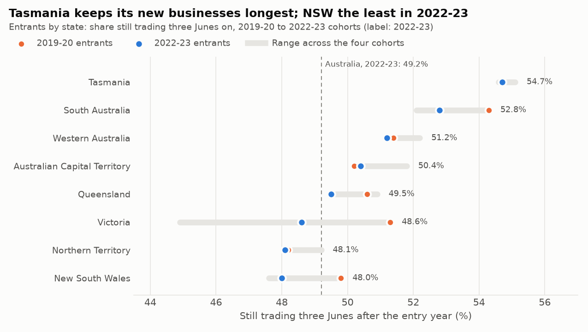
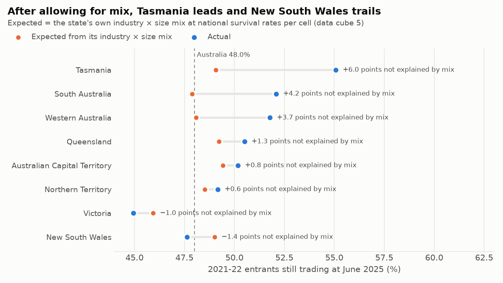
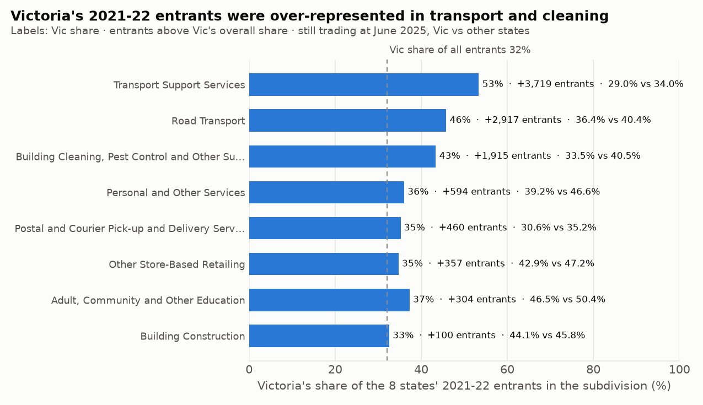
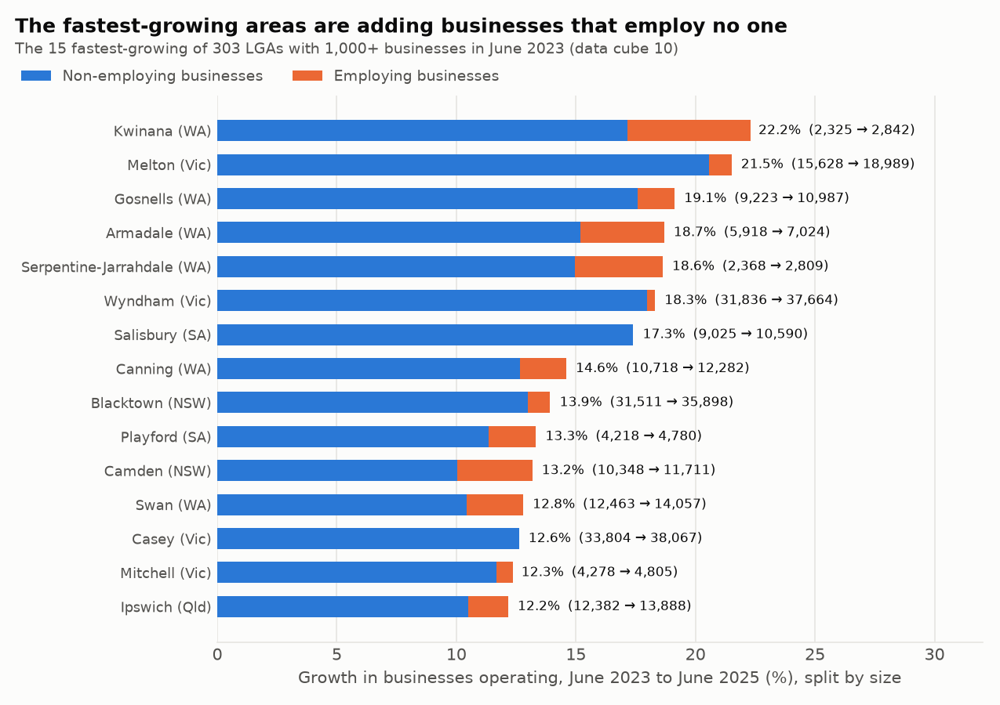
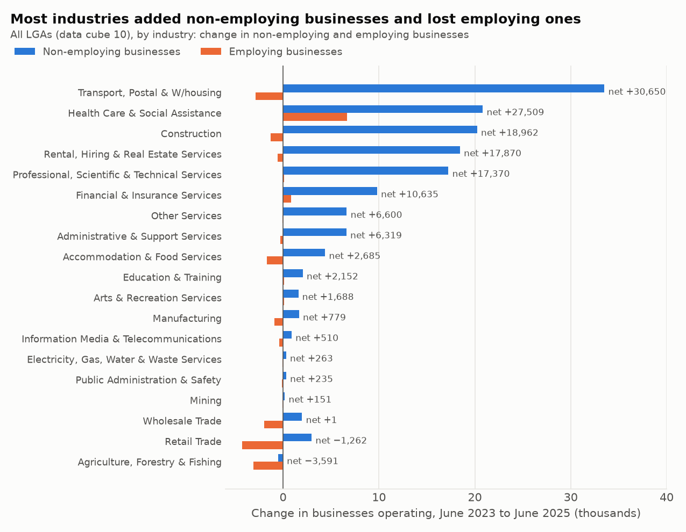

# Part 3: where new businesses last, and where business numbers are growing

*Generated by `scripts/regions_report.py` from the snapshot in `data/`. Do not edit by hand.*

Part 1's rules apply: survival means "still actively trading" at 30 June (an exit isn't a failure); survival below state level isn't published, so states are compared on survival and local government areas (LGAs) on growth in business numbers; states are compared within size bands or after allowing for their mix; no rate on a base of 20 businesses or fewer; 'Other Territories/Currently Unknown' is left out of rankings.

## At a glance

- **Tasmania keeps its new businesses longest, in every cohort.** 54.7% of its 2022-23 entrants were still trading three Junes on, against 49.2% nationally; New South Wales was lowest at 48.0%.
- **Allowing for mix changes the picture.** Given each state's industry × size mix, New South Wales would be expected to keep 49.0% of its 2021-22 entrants; it kept 47.6%, 1.4 points fewer, the weakest of the 8 states on that basis. Tasmania kept 6.0 points more than its mix predicts, then South Australia (+4.2 points) and Western Australia (+3.7 points).
- **Victoria's weak 2021-22 cohort is mostly mix.** Its entrants were 3.1 points below the national rate; 2.0 points of that is its industry × size mix. That year Victoria had 142,015 entrants (32.1% of Australia's), and was over-represented in Transport Support Services (53% of the 8 states' entrants), Road Transport (46%) and Building Cleaning, Pest Control and Other Support Services (43%).
- **Business numbers grew by 139,482 across LGAs from June 2023 to June 2025, and more than all of it was in businesses that employ no one:** non-employing businesses grew by 149,180 and employing businesses fell by 9,698. In the 20 fastest-growing LGAs with 1,000+ businesses, 91.8% of the net increase employed no one and 39.5% was in Transport, Postal and Warehousing.
- **The fastest-growing LGAs** with 1,000+ businesses are Kwinana (WA, 22.2%), Melton (Vic, 21.5%), Gosnells (WA, 19.1%), Armadale (WA, 18.7%) and Serpentine-Jarrahdale (WA, 18.6%). 31 of the 303 LGAs shrank.

## 1. Four cohorts by state (data cube 1, not perturbed)

Share of each cohort's entrants still trading three Junes after the entry year, and of all businesses operating in June still trading four Junes later. Sorted by the 2022-23 cohort; rank 1 = lowest of the 8 states.

| State | 2019-20 | 2020-21 | 2021-22 | 2022-23 | Change | 2022-23 entrants | Rank 2022-23 | All businesses, June 2019 | All businesses, June 2022 |
|---|---|---|---|---|---|---|---|---|---|
| New South Wales | 49.8% | 49.3% | 47.6% | 48.0% | −1.8 | 138,093 | 1 | 64.1% | 62.0% |
| Northern Territory | 48.2% | 48.9% | 49.2% | 48.1% | −0.1 | 2,673 | 2 | 64.7% | 61.8% |
| Victoria | 51.3% | 49.1% | 44.9% | 48.6% | −2.7 | 114,614 | 3 | 64.5% | 60.1% |
| Queensland | 50.6% | 50.9% | 50.5% | 49.5% | −1.1 | 78,612 | 4 | 64.0% | 62.3% |
| Australian Capital Territory | 50.2% | 51.8% | 50.2% | 50.4% | +0.2 | 6,210 | 5 | 62.0% | 59.7% |
| Western Australia | 51.4% | 52.2% | 51.8% | 51.2% | −0.2 | 37,310 | 6 | 65.0% | 63.6% |
| South Australia | 54.3% | 53.6% | 52.1% | 52.8% | −1.5 | 22,646 | 7 | 67.1% | 64.6% |
| Tasmania | 54.7% | 54.6% | 55.1% | 54.7% | 0.0 | 5,990 | 8 | 67.8% | 65.0% |
| **Australia** | 50.8% | 50.1% | 48.0% | 49.2% | −1.6 | 406,365 | | 64.5% | 61.9% |

Change is in percentage points, 2019-20 to 2022-23.

- **South Australia and Tasmania are the top two in all four cohorts**, Tasmania first every time. Their entrants' survival was 52.1% or more in every cohort.
- **Victoria moves the most:** 51.3% for the 2019-20 cohort, 44.9% for 2021-22 (lowest of any state in any cohort), back to 48.6% for 2022-23. Its 2021-22 entries (142,015) were 40,320 more than the year before and 27,401 more than the year after (section 3).
- **Business numbers grew in every state.** Between June 2019 and June 2026, the Australian Capital Territory grew fastest (30.4%) and Tasmania slowest (19.3%); Australia 24.1%. Tasmania also had the lowest entry rate (13.7% of businesses operating at the start of each year, against 16.5% nationally), so high survival there comes with fewer entrants.

| State | Businesses June 2019 | Businesses June 2026 | Growth | Entry rate | Exit rate |
|---|---|---|---|---|---|
| New South Wales | 772,771 | 942,658 | 22.0% | 16.5% | 13.5% |
| Victoria | 611,754 | 773,986 | 26.5% | 17.3% | 13.8% |
| Queensland | 436,848 | 543,277 | 24.4% | 16.1% | 13.2% |
| South Australia | 143,045 | 174,310 | 21.9% | 14.8% | 11.9% |
| Western Australia | 221,765 | 278,520 | 25.6% | 16.0% | 12.7% |
| Tasmania | 37,795 | 45,094 | 19.3% | 13.7% | 11.5% |
| Northern Territory | 14,243 | 17,440 | 22.4% | 17.0% | 13.5% |
| Australian Capital Territory | 28,968 | 37,785 | 30.4% | 18.3% | 14.3% |
| **Australia** | 2,268,998 | 2,814,778 | 24.1% | 16.5% | 13.4% |

Entry and exit rates: entries (exits) over businesses operating at the start of the year, summed over the 7 years 2019-20 to 2025-26, each year from the latest release that has it.

## 2. Is it the state, or what its new businesses do? (2021-22 entrants, data cube 5)

A state's survival depends on which industries its entrants are in and how many employ staff. To separate that from the state itself, each state's *expected* rate applies the national survival rate of each industry division × size band (non-employing, 1-4, 5+) to the state's own entrants in that cell. Actual minus expected is what the mix doesn't explain. This is indirect standardisation, which never needs a survival rate from a small state cell.

A state's actual rate comes from data cube 5's state-total rows, which match data cube 1 exactly. Summing the state's own subdivision × size cells would put small states too low: Northern Territory comes out at 46.9% from its cells against 49.2% published (−2.3 points), because hundreds of tiny perturbed cells are summed.

| State | Actual | Expected from mix | Gap to Australia | From the mix | Not explained by mix | Rank (not explained) |
|---|---|---|---|---|---|---|
| New South Wales | 47.6% | 49.0% | −0.4 points | +1.1 points | −1.4 points | 1 |
| Victoria | 44.9% | 45.9% | −3.1 points | −2.0 points | −1.0 points | 2 |
| Northern Territory | 49.2% | 48.5% | +1.2 points | +0.6 points | +0.6 points | 3 |
| Australian Capital Territory | 50.2% | 49.4% | +2.2 points | +1.5 points | +0.8 points | 4 |
| Queensland | 50.5% | 49.2% | +2.5 points | +1.3 points | +1.3 points | 5 |
| Western Australia | 51.8% | 48.1% | +3.8 points | +0.2 points | +3.7 points | 6 |
| South Australia | 52.1% | 47.9% | +4.1 points | 0.0 points | +4.2 points | 7 |
| Tasmania | 55.1% | 49.1% | +7.1 points | +1.1 points | +6.0 points | 8 |
| **Australia** | 48.0% | | | | | |

The parts add up: gap = from the mix + not explained − 0.08 points. The 0.08 is the difference between the national rate on the cells used (47.9%; they leave out unknown industries and Other Territories) and the published 48.0%.

- **New South Wales is weaker than its raw rate shows.** Its mix should put it 1.1 points above the national rate; it ends up 0.4 points below it. Within size bands, its non-employing entrants are 3rd lowest of the 8 states and its 1-4 employee entrants the lowest (57.2%).
- **Victoria's gap is 65% mix.** 79% of its 2021-22 entrants employed no one (Australia 74%), the highest share of any state, and many were in low-survival subdivisions (section 3). After the mix it is 2nd lowest, −1.0 points.
- **Tasmania, South Australia and Western Australia keep more of their entrants than their mix predicts** (+6.0 points, +4.2 points, +3.7 points). They also have the three highest survival rates for 1-4 employee entrants, so the advantage holds within size bands too.
- **The method holds up.** With subdivision × 2 size bands, or subdivision × 5 sizes, instead of division × 3 bands, each state's unexplained part moves by at most 0.18 points and the ranking is the same apart from NT and ACT, which swap.

**Within size bands** (state-total rows, exact; national size-mix weights as in Part 2):

| State | Entrants | Non-employing share | Non-employing | 1-4 | 5+ | Overall | At national size mix |
|---|---|---|---|---|---|---|---|
| Victoria | 142,015 | 79% | 40.4% | 60.7% | 71.1% | 44.9% | 46.0% |
| New South Wales | 143,455 | 70% | 43.3% | 57.2% | 66.6% | 47.6% | 47.2% |
| Northern Territory | 2,762 | 69% | 42.5% | 62.2% | 75.2% | 49.2% | 48.0% |
| Australian Capital Territory | 6,592 | 65% | 44.7% | 59.8% | 64.8% | 50.2% | 48.8% |
| Queensland | 79,509 | 71% | 45.4% | 61.9% | 71.6% | 50.5% | 50.0% |
| Western Australia | 38,293 | 74% | 47.0% | 64.2% | 73.0% | 51.8% | 51.8% |
| South Australia | 23,404 | 76% | 48.2% | 63.3% | 73.3% | 52.1% | 52.5% |
| Tasmania | 6,155 | 69% | 50.1% | 64.9% | 76.5% | 55.1% | 54.3% |

## 3. Victoria's 2021-22 cohort

Victoria's share of Australia's entrants was 27.8% in 2020-21, 32.1% in 2021-22 and 28.2% in 2022-23. Data cube 5 shows where the 2021-22 entrants were. Victoria had 32.1% of the 8 states' entrants overall, but far more in a few subdivisions:

| Subdivision | Vic entrants | Vic share | Above Vic's overall share | Still trading, Vic | Still trading, other states |
|---|---|---|---|---|---|
| Transport Support Services | 9,336 | 53% | 3,719 | 29.0% | 34.0% |
| Road Transport | 9,757 | 46% | 2,917 | 36.4% | 40.4% |
| Building Cleaning, Pest Control and Other Support Services | 7,374 | 43% | 1,915 | 33.5% | 40.5% |
| Personal and Other Services | 5,463 | 36% | 594 | 39.2% | 46.6% |
| Postal and Courier Pick-up and Delivery Services | 5,255 | 35% | 460 | 30.6% | 35.2% |
| Other Store-Based Retailing | 4,768 | 35% | 357 | 42.9% | 47.2% |
| Adult, Community and Other Education | 2,192 | 37% | 304 | 46.5% | 50.4% |
| Building Construction | 7,164 | 33% | 100 | 44.1% | 45.8% |

- The top 3 account for 8,551 entrants above Victoria's overall share. In Part 2 they are 3rd, 4th and 7th lowest of the 54 subdivisions with 500+ entrants, at the national size mix, and Victoria's entrants in them did worse than other states' (29.0% vs 34.0% in Transport Support Services).
- Removing those 8,551 entrants at Victoria's own rate in each subdivision would lift its 2021-22 rate from 44.9% to 45.7%. The rest of the gap is the high non-employing share and lower survival within the same subdivisions.
- The data can't say why Victoria's entrants were over-represented there in 2021-22; one cohort of detail is published. The 2022-23 cohort (48.6%) is back near the national rate.

## 4. Where business numbers are growing (LGAs, June 2023 to June 2025, data cube 10)

Businesses operating in each of 547 places (LGAs, plus unincorporated areas; 'No usual address' and Other Territories left out; the ACT is one area). Survival isn't published below state level, so this section is about growth in business numbers, not survival. League tables use the 303 LGAs with 1,000 or more businesses in June 2023 (96.8% of all businesses).

**Fastest-growing 20**

| LGA | State | June 2023 | June 2025 | Growth | Employing growth | Non-employing share of the increase | Industry adding the most |
|---|---|---|---|---|---|---|---|
| Kwinana | WA | 2,325 | 2,842 | 22.2% | 15.0% | 77% | Transport, Postal and Warehousing (+190) |
| Melton | Vic | 15,628 | 18,989 | 21.5% | 3.1% | 96% | Transport, Postal and Warehousing (+1,475) |
| Gosnells | WA | 9,223 | 10,987 | 19.1% | 5.0% | 92% | Transport, Postal and Warehousing (+1,083) |
| Armadale | WA | 5,918 | 7,024 | 18.7% | 10.4% | 81% | Transport, Postal and Warehousing (+494) |
| Serpentine-Jarrahdale | WA | 2,368 | 2,809 | 18.6% | 10.4% | 80% | Construction (+93) |
| Wyndham | Vic | 31,836 | 37,664 | 18.3% | 1.2% | 98% | Transport, Postal and Warehousing (+2,531) |
| Salisbury | SA | 9,025 | 10,590 | 17.3% | −0.2% | 100% | Transport, Postal and Warehousing (+660) |
| Canning | WA | 10,718 | 12,282 | 14.6% | 5.6% | 87% | Transport, Postal and Warehousing (+807) |
| Blacktown | NSW | 31,511 | 35,898 | 13.9% | 2.3% | 93% | Transport, Postal and Warehousing (+1,880) |
| Playford | SA | 4,218 | 4,780 | 13.3% | 6.2% | 85% | Transport, Postal and Warehousing (+242) |
| Camden | NSW | 10,348 | 11,711 | 13.2% | 6.4% | 76% | Health Care and Social Assistance (+219) |
| Swan | WA | 12,463 | 14,057 | 12.8% | 6.3% | 82% | Transport, Postal and Warehousing (+652) |
| Casey | Vic | 33,804 | 38,067 | 12.6% | 0.0% | 100% | Transport, Postal and Warehousing (+1,275) |
| Mitchell | Vic | 4,278 | 4,805 | 12.3% | 1.9% | 95% | Transport, Postal and Warehousing (+267) |
| Ipswich | Qld | 12,382 | 13,888 | 12.2% | 4.2% | 86% | Transport, Postal and Warehousing (+463) |
| Karratha | WA | 1,187 | 1,326 | 11.7% | 2.1% | 93% | Construction (+32) |
| Belmont | WA | 4,531 | 5,054 | 11.5% | 4.2% | 87% | Transport, Postal and Warehousing (+247) |
| Logan | Qld | 26,410 | 29,449 | 11.5% | 4.4% | 85% | Transport, Postal and Warehousing (+1,044) |
| Tea Tree Gully | SA | 5,888 | 6,538 | 11.0% | 3.7% | 88% | Transport, Postal and Warehousing (+214) |
| Port Adelaide Enfield | SA | 11,465 | 12,721 | 11.0% | 2.6% | 92% | Transport, Postal and Warehousing (+384) |

- **WA 8, Vic 4, SA 4, NSW 2, Qld 2** of the 20. Transport, Postal and Warehousing added the most businesses in 17 of them.
- **Across those 20, businesses grew by 35,959 (14.6%)**: non-employing 33,004 (20.6%), employing 2,955. Transport, Postal and Warehousing added 14,231 (28.7% growth), 14,664 of them non-employing.
- **Counting employers tells a different story.** Total and employing growth are related but far from the same (correlation 0.64 across the 303 LGAs). The fastest employing growth was in Kwinana (WA, 15.0%), Murray (WA, 13.1%), Capel (WA, 13.0%), Serpentine-Jarrahdale (WA, 10.4%) and Armadale (WA, 10.4%). 199 of the 303 LGAs lost employing businesses even though only 31 lost businesses overall.

**Slowest-growing and shrinking** (31 of 303 shrank)

| LGA | State | June 2023 | June 2025 | Growth | Employing growth |
|---|---|---|---|---|---|
| Glen Innes Severn | NSW | 1,150 | 1,090 | −5.2% | −7.2% |
| Berri Barmera | SA | 1,013 | 976 | −3.7% | −12.9% |
| Hinchinbrook | Qld | 1,328 | 1,286 | −3.2% | −2.3% |
| Glenelg | Vic | 1,956 | 1,902 | −2.8% | −8.2% |
| Inverell | NSW | 1,808 | 1,761 | −2.6% | −2.9% |
| Snowy Valleys | NSW | 1,701 | 1,664 | −2.2% | −4.8% |
| Warrumbungle Shire | NSW | 1,247 | 1,220 | −2.2% | 1.4% |
| Campaspe | Vic | 4,466 | 4,374 | −2.1% | −3.9% |
| Burdekin | Qld | 2,090 | 2,049 | −2.0% | −2.9% |
| Nillumbik | Vic | 6,418 | 6,299 | −1.9% | −7.8% |

**By state** (LGAs with 1,000+ businesses)

| State | LGAs | Shrinking | Median growth | Lowest | Highest |
|---|---|---|---|---|---|
| New South Wales | 97 | 11 | 3.2% | −5.2% | 13.9% |
| Victoria | 71 | 12 | 1.9% | −2.8% | 21.5% |
| Queensland | 39 | 3 | 3.6% | −3.2% | 12.2% |
| South Australia | 36 | 4 | 3.9% | −3.7% | 17.3% |
| Western Australia | 42 | 0 | 5.9% | 0.9% | 22.2% |
| Tasmania | 13 | 1 | 2.2% | −0.8% | 5.4% |
| Northern Territory | 4 | 0 | 5.1% | 2.2% | 7.1% |
| Australian Capital Territory | 1 | 0 | 5.4% | 5.4% | 5.4% |

- **Western Australia: none of its 42 LGAs shrank** and its median growth (5.9%) is the highest of the states with more than one LGA. Victoria has the most shrinking LGAs (12 of 71) and the lowest median (1.9%), yet Melton and Wyndham are 2nd and 6th fastest-growing: growth is concentrated, not spread.
- 81 of the 303 LGAs grew faster than all places together (5.4%).

**By industry and size, all places**

| Size | June 2023 | June 2025 | Change | Growth |
|---|---|---|---|---|
| Non employing | 1,579,522 | 1,728,702 | +149,180 | 9.4% |
| 1-4 | 701,626 | 687,161 | −14,465 | −2.1% |
| 5-19 | 230,528 | 231,429 | +901 | 0.4% |
| 20-199 | 62,905 | 66,303 | +3,398 | 5.4% |
| 200+ | 2,638 | 3,106 | +468 | 17.7% |

- **14 of 19 industries had fewer employing businesses** in June 2025 than in June 2023. Transport, Postal and Warehousing added 30,650 businesses, the most of any industry (22.0% of the net increase): 33,515 non-employing, −2,865 employing. Health Care and Social Assistance added the most employing businesses (+6,679).
- The 1-4 employee band shrank (−14,465) while 20-199 grew (5.4%). Size is measured each June, so businesses move between bands as they hire or shed staff; a fall in one band isn't the same as businesses closing.

## 5. What this means for the business

- **Councils and economic-development teams:** don't read a rising business count as a growing local economy. In the 20 fastest-growing LGAs 92% of the increase was businesses with no employees, and 40% was in Transport, Postal and Warehousing, the industry with the lowest survival of 2022-23 entrants in Part 2. Track employing businesses (published in the same cube) alongside the total.
- **State agencies:** compare survival after the mix. On raw rates New South Wales is 0.4 points below the national rate; after its mix it is the weakest state (−1.4 points). The data can't say why, but it is the gap worth investigating. Victoria's 2021-22 dip is 65% mix, so it isn't mainly a Victorian problem.
- **Lenders and investors:** state matters, but less than industry and size. The unexplained state effects run from −1.4 points to +6.0 points; among non-employing entrants alone, industries run from 30.3% to 58.9% (Part 2), 28.5 points apart. A state adjustment fine-tunes the industry × size rate.

## Caveats

- Sections 2 and 3 cover one cohort (2021-22 entrants to June 2025). Data cube 1 (section 1) shows how much a single cohort moves, and the 2026 detail is due on 18 December 2026.
- Expected rates remove the effect of industry division × size band, not of anything else (finer industry detail, local costs, the owners themselves). The robustness check with subdivisions moves the result little.
- LGA counts are perturbed (sizes add to the published total within ±4 businesses, industries within ±11), so growth is only ranked for LGAs with 1,000+ businesses. For the same reason the net change summed by size (139,482) and by industry (139,312) differ slightly; industry shares use the industry sum.
- ABS attributes a business that operates in several places to one area only, so an LGA's count doesn't capture every business operating there.
- A change in business numbers is entries minus exits plus businesses moving in or out of an area, so it isn't the same as start-up activity.

## Output files

- `results/state_cohorts.csv`: states, survival of four entry cohorts and of all businesses, ranks
- `results/state_flows.csv`: states, businesses June 2019 and June 2026, entries, exits, entry and exit rates
- `results/state_mix.csv`: states, 2021-22 entrants by size band, expected rate from the mix, the split, and the unexplained part under the two other cell definitions
- `results/state_excess_vic.csv`: Victoria's 2021-22 entrants by subdivision vs the other states
- `results/lga_growth.csv`: every place, businesses and employing businesses in June 2023 and 2025, growth, the industry adding the most, and whether it is above the floor
- `results/lga_growth_by_industry.csv`: change by industry, non-employing and employing, all places and the 20 fastest-growing LGAs
