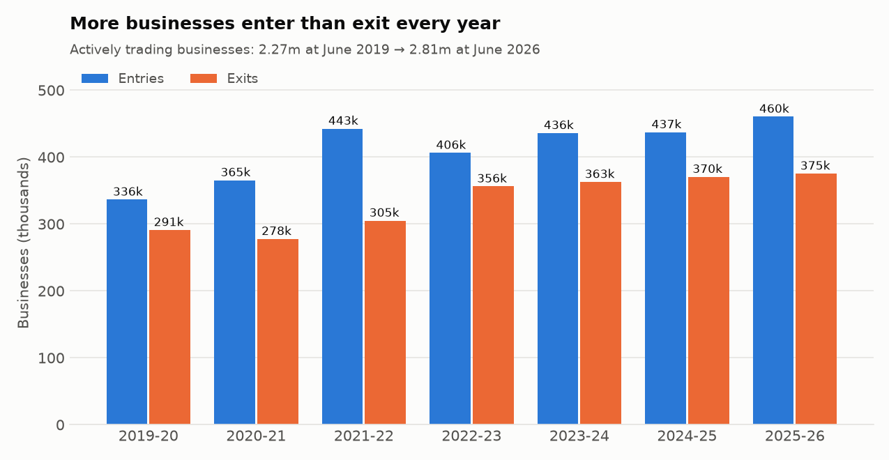
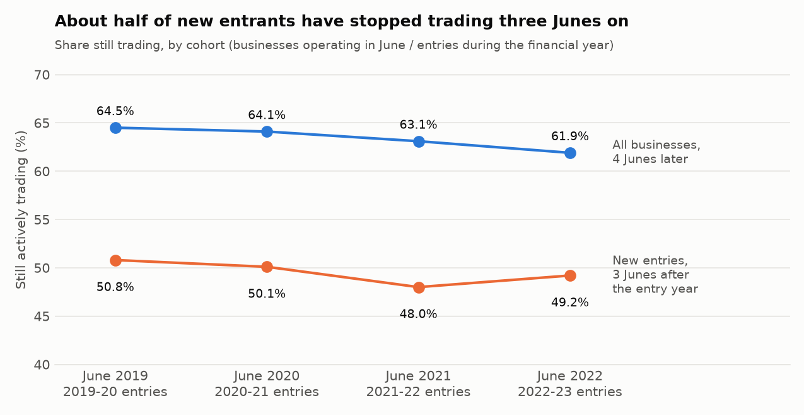
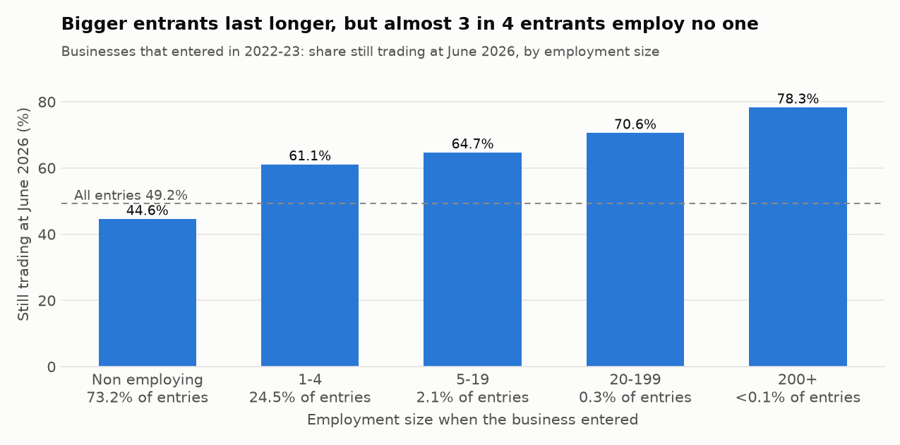
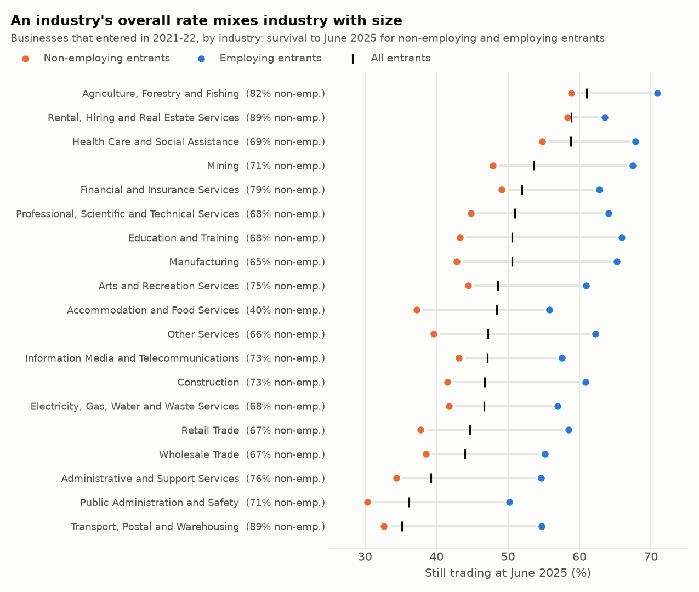
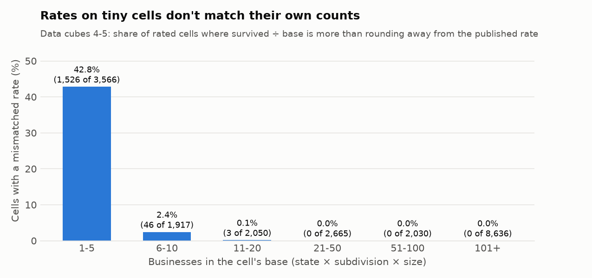

# Part 1: source profile

*Generated by `scripts/profile_source.py` from the snapshot in `data/`. Do not edit by hand.*

## Source

Australian Bureau of Statistics, *Counts of Australian Businesses, including Entries and Exits* (CABEE, cat. no. 8165.0). Licence: CC BY 4.0, © Commonwealth of Australia. CABEE counts every actively trading business on the ABS Business Register (an ABN that is registered for and remitting GST, plus the large, complex businesses ABS profiles directly) at 30 June each year.

| File | Release | What it gives |
|---|---|---|
| Data cube 1 | June 2019 – June 2023 | national and state counts, entries, exits, survival (not perturbed) |
| Data cube 1 | June 2020 – June 2024 | national and state counts, entries, exits, survival (not perturbed) |
| Data cube 1 | June 2021 – June 2025 | national and state counts, entries, exits, survival (not perturbed) |
| Data cube 1 | June 2022 – June 2026 | national and state counts, entries, exits, survival (not perturbed) |
| Data cubes 4 and 5 | June 2021 – June 2025 | survival of businesses and entries by state × ANZSIC subdivision × employment size (perturbed) |
| Data cube 10 | June 2021 – June 2025 | business counts by LGA × industry division × employment size, June 2023-2025 (perturbed) |

The August 2026 release has data cube 1, tables 1-16 only; its detailed cubes are due on 18 December 2026, so the state × subdivision and LGA views are one release behind.

## At a glance

- **2,814,778 businesses** were actively trading at June 2026, up 24.1% from 2,268,998 at June 2019. Entries outnumbered exits in every one of the 7 years from 2019-20 to 2025-26.
- Of the **406,365 businesses that entered in 2022-23**, 199,742 (49.2%) were still trading at June 2026. For the 2019-20 entrants the same figure was 50.8%; the low point was the 2021-22 cohort at 48.0%.
- Of the 2,539,724 businesses trading at June 2022, 61.9% were still trading four years later, down from 64.5% for the June 2019 cohort.
- 73.2% of 2022-23 entrants employed no one. 44.6% of them were still trading at June 2026, against 61.5% of employing entrants.

Survival of each entry cohort, by June after the entry year:

| Entered in | 1st June | 2nd June | 3rd June |
|---|---|---|---|
| 2019-20 | 76.9% | 60.5% | 50.8% |
| 2020-21 | 76.5% | 59.3% | 50.1% |
| 2021-22 | 75.0% | 56.7% | 48.0% |
| 2022-23 | 75.9% | 58.1% | 49.2% |

## Checks

| Check | Result |
|---|---|
| Data cube 1: published rate vs survived ÷ base | 1,288 rates, largest gap 0.050 points, 0 beyond rounding |
| Data cube 1: groups + 'unknown' add to the total | 140 tables across 5 dimensions, largest gap 0 businesses |
| Survival base for entries = entries in the counts table | equal in every release, industry and state (checked in tests) |
| National totals across overlapping releases | 40 overlapping cells, 0 revised |
| Industry and state groups across overlapping releases | 523 of 540 overlapping cells revised, median 0.10%, largest named group Retail Trade (operating start, 2021-22): 147,533 to 149,110 (1.1%) |
| Data cubes 4/5 state totals vs data cube 1 (June 2021 – June 2025) | 70 pairs, largest gap 0 (base), 0 (survived), 0.0 (rate) |
| Division rates rebuilt from data cube 5's cells vs data cube 1's published rates | within 0.78 points (largest: Mining) |
| Data cubes 4/5: size bands add to the row total | 2,266 of 5,418 rows don't, by −4 to +5 businesses |
| Data cube 10: national total = data cube 1's June count | yes for June 2023, 2024 and 2025 (2,589,873, 2,662,998, 2,729,648) |
| Data cube 10: LGAs add to their state | within −0.82% to +0.03% (worst Northern Territory −0.82%, South Australia −0.53%) |
| Data cube 10: industries add to the LGA total | 60% of LGA-years don't, by −11 to +10 |

## Traps, and the rule each one sets

1. **An exit isn't a failure.** ABS counts an exit when a business stops actively trading: a cancelled ABN (closed, sold, restructured or moved overseas) or a long-term GST non-remitter. In 2025-26, 79.3% of the 375,331 exits were cancellations and the rest 'other exits'. **Rule:** say "still trading" or "exited", never "failed".
2. **Not every entry is a new business.** 'Other entries' (re-activated ABNs, non-remitters resuming GST, businesses coming into scope) were 28.5% to 31.7% of entries each year. A business that starts and stops between two 30 Junes is never counted at all, so true early closures are higher than any CABEE rate shows. **Rule:** call the cohort "entries", not "start-ups", and note that survival is measured at 30 June only.
3. **The two survival tables measure different things.** 'Businesses' follows everything trading at the first June, new or long-established, for four Junes; 'entries' follows that year's newcomers, first counted at the June ending their entry year, for three. 61.9% vs 49.2% in the latest release is not a like-for-like gap. **Rule:** new-business questions use the entries tables, and every rate names its cohort and its June.
4. **Size mix drives industry rankings.** Non-employing entrants survive at 44.6% vs 61.5% for employing ones, and the non-employing share of entries ranges from 40% to 89% by industry (2021-22 entrants). Accommodation and Food Services has the lowest share (40%), so its overall rate is 10th lowest of 19, but its employing entrants' rate is 5th lowest. Rental, Hiring and Real Estate Services and Transport, Postal and Warehousing are both about 89% non-employing, yet survive at 58.9% and 35.1%. **Rule:** compare industries within a size band (or at a common size mix), not on the overall rate alone.
5. **Releases revise groups, not totals.** National totals never changed between overlapping releases, but industry and state groups did (median 0.10%, up to 1.1% for a named group and 81% for the 'unknown' rows: industry not yet coded, or state unknown). **Rule:** a time series takes each year from the latest release that has it; a single comparison never mixes releases.
6. **Detail cells are perturbed, and tiny ones mislead.** In data cubes 4/5, 1,575 of 20,864 rated cells have a published rate 6.7 to 100 points away from their own counts, all with a base of 15 businesses or fewer (42.8% of cells with 1-5 businesses, none above 20). Rates rebuilt by summing cells to divisions land within 0.78 points of the unperturbed figures. **Rule:** no rate on a base of 20 businesses or fewer; aggregate cells first, then compute the rate.
7. **Regions below state level have counts, not survival.** Survival is published by state only; data cube 10 gives 557 LGAs' business counts. Multi-state businesses sit in each state's 'No usual address' row (0.43% to 0.45% of businesses), and some LGAs have blank rows (Christmas Island, Mapoon, Maralinga Tjarutja, Menzies, Ngaanyatjarraku, Wujal Wujal). **Rule:** regional survival is a state comparison; LGAs are compared on growth in business numbers, with a floor on the base.
8. **'Currently Unknown' has counts but no rates.** It is kept in totals and left out of rankings.

## Output files

- `results/headline.csv`: national survival by release
- `results/flow_series.csv`: national entries, exits and counts, each year from the latest release
- `results/division_size_mix.csv`: 2021-22 entrants by industry division, size mix and survival to June 2025
- `results/small_cells.csv`: mismatched rates by base size
